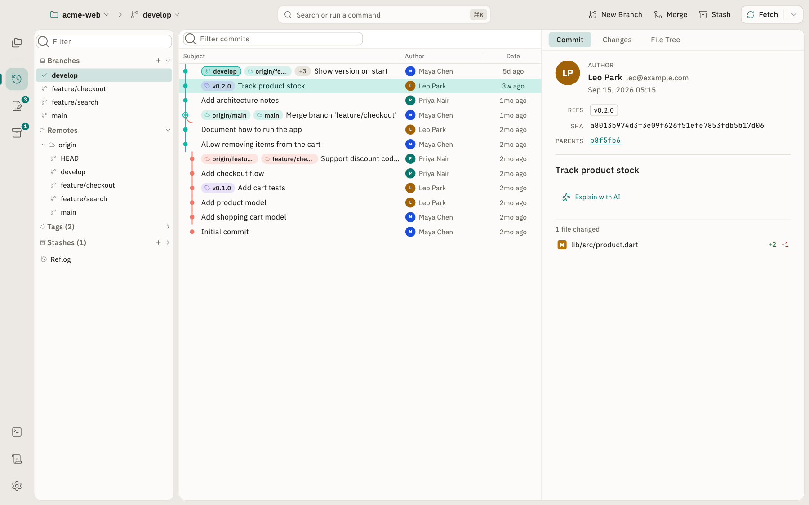
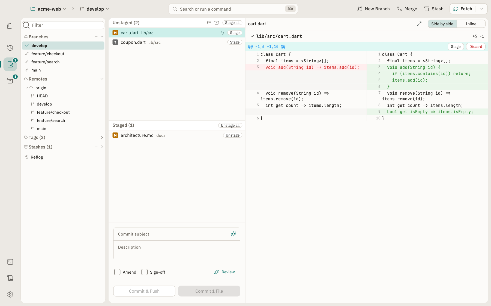
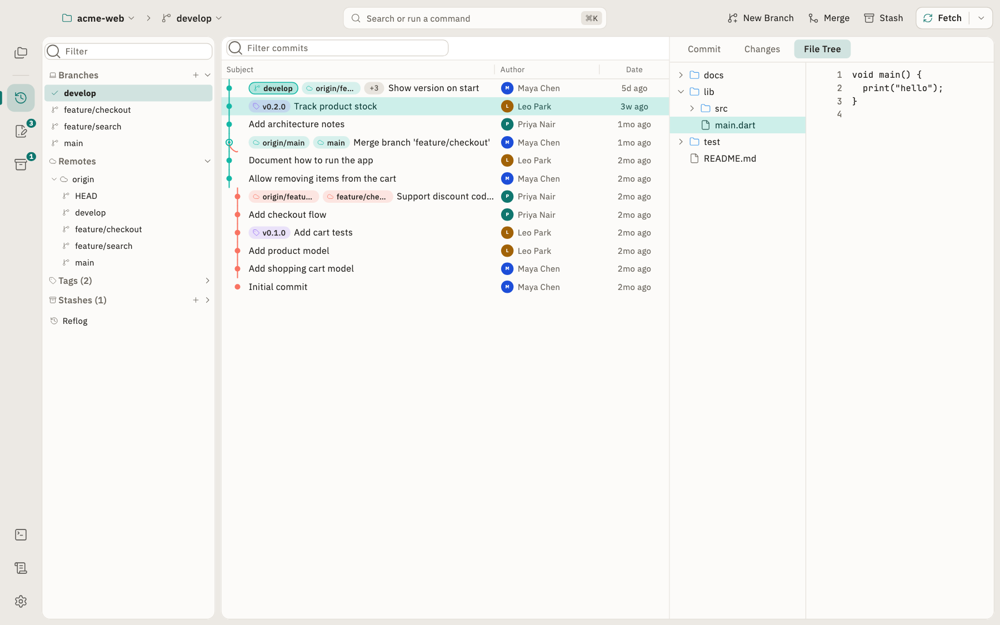
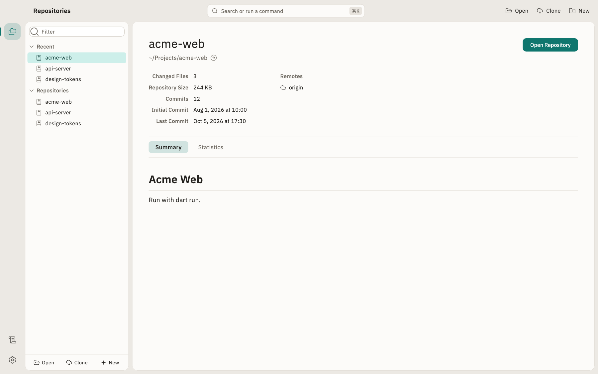
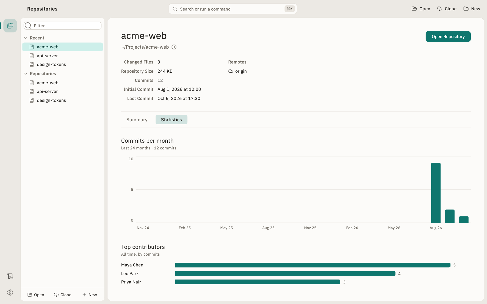
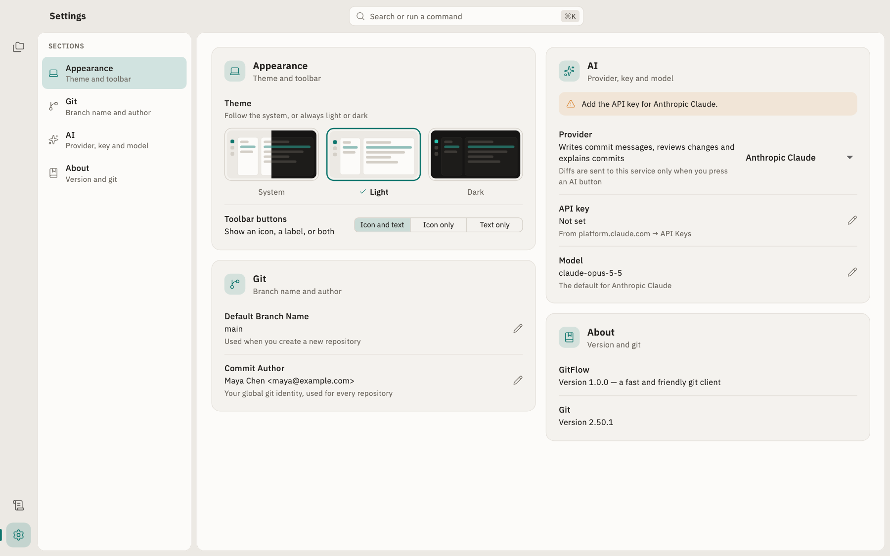
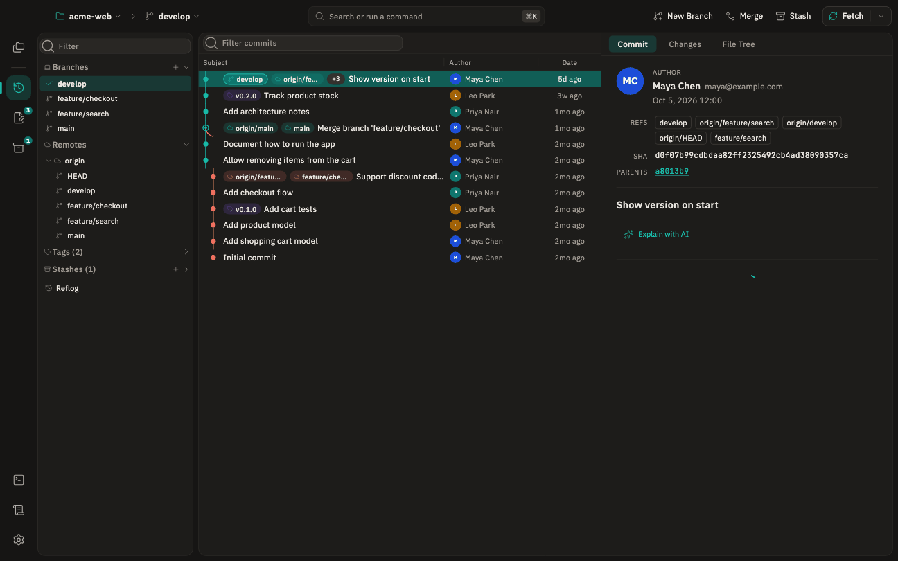
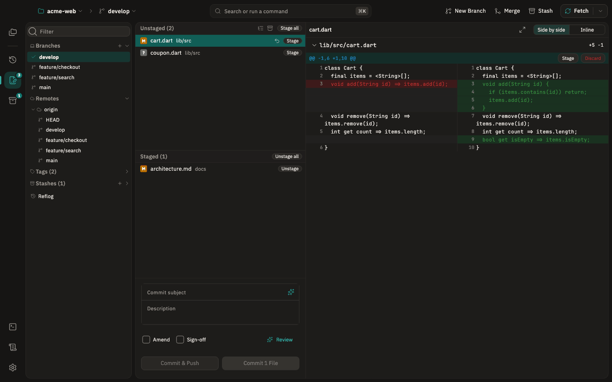
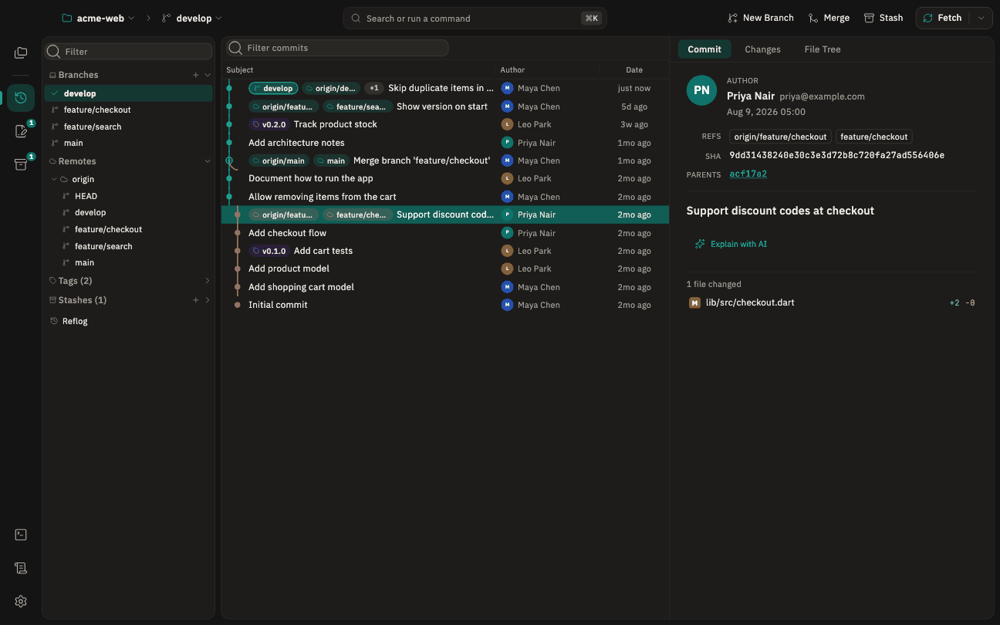

# GitFlow

A fast and friendly desktop Git client built with Flutter. GitFlow drives
your installed `git` command line, so it works with your existing
repositories, config and credentials.

> [!WARNING]
> GitFlow is still in development, so you may run into bugs. Do not use it
> for production purposes, and keep backups of any repository you open
> with it.

**[Download the latest release](https://github.com/anil291987/GitFlow/releases/latest)**

This repository hosts GitFlow's releases, documentation and issue
tracker. The source code is not public.

<picture>
  <source media="(prefers-color-scheme: dark)" srcset="docs/screenshots/history-dark.png">
  
</picture>

## Features

**Repositories**
- Repository manager with Recent and grouped repositories, plus Open, Clone
  and New
- Switch between open repositories from the name at the top left; the
  rail on the left switches between History, Changes and Stashes
- Views refresh by themselves when files change outside GitFlow (an editor,
  `git` in a terminal) and whenever the window regains focus
- Repository summary: changed files, size, commit count, first and last
  commit, remotes with GitHub / Issues / Pull Requests links, and the README
- Statistics: commits per month and top contributors

**History**
- Commit graph with branch, remote and tag badges, author avatars, SHA and
  date (the SHA and author name step aside when the list is narrow); filter
  by subject, author or SHA. Loads 1,000 commits at a time, and older ones
  as you scroll to the end
- An inspector beside the list shows the selected commit: author, refs,
  SHA, clickable parents, message, and changed files with line counts
- Changes tab (the full diff) and File Tree tab (browse the repository as of
  that commit) in the inspector
- Commit menu: check out, new branch or tag here, cherry-pick, revert, merge,
  rebase onto, interactive rebase, reset, copy SHA or message

**Local changes**
- Unstaged and Staged lists, flat or as a folder tree. A file with both
  staged and unstaged edits appears in both lists
- Stage, unstage or discard whole files or single hunks; delete untracked
  files
- Untracked files show their full contents as added
- Commit box with subject, description, Amend, Sign-off, and Commit & Push

**Diffs**
- Side-by-side or inline view, with removed and added lines paired up
- Full-window diff view

**Branches, tags and stashes**
- Sidebar with local branches (ahead/behind counts), remotes, tags,
  stashes and reflog
- Double-click a branch to check it out. For a remote branch such as
  `origin/feature`, this creates a local `feature` that tracks it, or
  switches to `feature` if it already exists
- New branch from the current branch, any other branch or a commit, with
  the name checked as you type and an option to check it out
- Branch menu: check out, merge into current, rebase current onto, rename,
  delete (locally or on the remote)
- Stash create, apply, pop, drop and view

**Sync**
- One Sync button in the top bar runs what the branch needs next: Pull when
  it's behind, Push when it's ahead, otherwise Fetch. Its menu offers all
  three, plus Force Push. Each shows progress and a result message
- Push publishes a new branch and sets its upstream
- When the remote has commits you don't, Push offers to pull first or to
  force push (with lease)
- If a branch and its remote share no commits (both were started
  separately), Pull explains this and offers to merge the two histories
- When git can't authenticate, GitFlow asks for a username and password or
  token (HTTPS) or the SSH key's passphrase, and tries again. A configured
  credential helper saves HTTPS credentials. On Windows, Git Credential
  Manager shows its own sign-in window instead
- Clone shows git's progress and can be cancelled

**Conflicts and rebasing**
- Banners while a merge, rebase, cherry-pick or revert is in progress, with
  Continue and Abort
- Conflict resolver: use ours, use theirs, or edit the file and mark it
  resolved
- Interactive rebase: reorder commits, and pick, squash, fixup or drop each
  one

**AI**
- ✨ in the commit subject writes the subject and description from the
  staged changes, following the style of recent commits
- Review checks the staged changes for bugs, risky code and code quality,
  and lists findings by severity with file and line
- Explain with AI on a commit's details summarises what it does and flags
  anything risky
- Works with Anthropic Claude, OpenAI, GitHub Models, Google Gemini, Ollama
  or any OpenAI-compatible server. See [AI setup](#ai-setup)

**Also**
- Blame and file history views
- Built-in terminal, with output as it arrives and a Stop button, and a log
  of the git commands GitFlow runs
- A merge, rebase or stash that stops on conflicts takes you to Local
  Changes to resolve them
- Command palette (⌘K)
- Light, dark or system theme; top-bar buttons as icons, labels or both
- Git settings: default branch name, commit author, what Pull does
  (merge, rebase or fast-forward only), commit signing with a GPG or SSH
  key, and external merge and diff tools ("Open in …" in the conflict
  resolver and the Local Changes file menu)
- Automatic background fetch, and a diff text size
- Warns on the Repositories page when git is missing or older than 2.20
- Keyboard: Tab reaches the top bar; arrow keys move through commits and
  changed files; Space or Enter stages or unstages, Delete discards;
  Enter checks out the branch selected in the sidebar; Shift+F10 or the
  Menu key opens a row's context menu
- Available in English, Español, Français, Deutsch and हिन्दी. It follows
  the system language by default; choose one in Settings → Language

### Not yet available
- **GitHub pull requests and notifications.** The screens exist but are
  hidden, because they aren't connected to GitHub yet.
- Reword and edit steps in interactive rebase
- Image diffs, word-level diff highlighting, and a 3-way merge editor

## Screenshots

The window has three parts:

- **Top bar**: the repository and branch (click either to switch), a
  search field for commands (⌘K), branch actions, and the Sync button.
- **Rail** on the left: Repositories, then History, Changes and Stashes
  for the open repository, with Terminal, Command Log and Settings at the
  bottom.
- **Panels**: branches, remotes, tags and stashes on the left, and the
  selected view beside them.

The screenshots follow your GitHub theme, light or dark.

<table>
<tr>
<td width="50%">

**Local Changes**: Stage files or hunks, review the diff side by side, and commit

<picture>
  <source media="(prefers-color-scheme: dark)" srcset="docs/screenshots/local-changes-dark.png">
  
</picture>

</td>
<td width="50%">

**File Tree**: Browse the repository as it was at any commit

<picture>
  <source media="(prefers-color-scheme: dark)" srcset="docs/screenshots/file-tree-dark.png">
  
</picture>

</td>
</tr>
<tr>
<td width="50%">

**Repositories**: Recent and grouped repositories with a summary of each

<picture>
  <source media="(prefers-color-scheme: dark)" srcset="docs/screenshots/repositories-dark.png">
  
</picture>

</td>
<td width="50%">

**Statistics**: Commits per month and top contributors

<picture>
  <source media="(prefers-color-scheme: dark)" srcset="docs/screenshots/statistics-dark.png">
  
</picture>

</td>
</tr>
</table>

**Settings**: appearance, git configuration and the [AI provider](#ai-setup)

<picture>
  <source media="(prefers-color-scheme: dark)" srcset="docs/screenshots/settings-dark.png">
  
</picture>

## Video tutorials

Short clips of common tasks, recorded from GitFlow running against a demo
repository.

### Full demo

A walkthrough of GitFlow from start to finish:
[gitflow-demo.mp4](docs/videos/gitflow-demo.mp4) (opens in GitHub's video
player).

### Browse history

Select a commit to see its details, then open **Changes** for the full diff
or **File Tree** to browse the repository as of that commit.



### Stage and commit

1. Press ⌘2, or click **Changes** in the rail on the left, and select a
   file to see its diff.
2. Click **Stage** on the file, or on a single hunk in the diff.
3. Type a subject, or click ✨ to have AI write one.
4. Click **Commit**, or **Commit & Push** to push straight away.



### Create and check out a branch

1. Click **New Branch** in the top bar and type a name.
2. Click **Create**. The branch appears in the sidebar.
3. Double-click the branch to check it out.



## Keyboard shortcuts

On Windows and Linux, use Ctrl instead of ⌘.

| Shortcut | Action |
|---|---|
| ⌘K | Command palette |
| ⌘O | Open repository |
| ⌘W | Close repository |
| ⌘1 | History |
| ⌘2 | Changes |
| ⌘3 | Stashes |

## AI setup

The AI features need a provider. Open **Settings → AI**, pick one, and fill
in its key. You can also change its model, and for Ollama and custom
servers, its server URL. Each provider keeps its own settings, so you can
switch between them without retyping anything. Until the chosen provider is
set up, the AI buttons say what's missing instead of sending anything.

| Provider | Default model | Key | Where to get it |
|---|---|---|---|
| Anthropic Claude (default) | `claude-opus-5-5` | `ANTHROPIC_API_KEY` | platform.claude.com → API Keys |
| OpenAI | `gpt-5` | `OPENAI_API_KEY` | platform.openai.com → API keys |
| GitHub Models (Copilot) | `openai/gpt-4.1` | `GITHUB_TOKEN` | A personal access token with the "models: read" permission |
| Google Gemini | `gemini-2.5-flash` | `GEMINI_API_KEY` | aistudio.google.com → Get API key |
| Ollama (local) | `llama3.2` | none | Runs at `http://localhost:11434/v1` by default |
| OpenAI-compatible | you choose | optional | Your server's URL, e.g. OpenRouter, LM Studio or Groq |

- **Keys:** a key saved in Settings is used first. If there isn't one,
  GitFlow reads the environment variable in the table. A macOS app opened
  from Finder or the Dock doesn't see variables set in your shell profile,
  so either save the key in Settings or start GitFlow from a terminal.
- **Models:** leave the model field empty to use the default. Otherwise
  enter any model ID the provider offers.
- **Servers:** Ollama and OpenAI-compatible servers take a base URL ending
  in `/v1` (or the server's equivalent). Ollama needs the model pulled
  first, e.g. `ollama pull llama3.2`.

### What's sent, and when

Nothing is sent until you press an AI button. Then GitFlow sends:

| Feature | Where | What's sent |
|---|---|---|
| Write commit message | ✨ in the commit subject | The staged diff and recent commit subjects |
| Review | Commit box, next to Amend and Sign-off | The staged diff |
| Explain with AI | A commit's details | That commit's message and diff |

Diffs over 400K characters aren't sent; GitFlow says so instead of cutting
them short. Keys are stored in the app's preferences file (via
`shared_preferences`), not the system keychain. For a model that never
leaves your machine, use Ollama.

With Anthropic Claude, the commit message task runs at low effort and
reviews and explanations at medium effort. Commit messages and reviews use
structured output so the reply is always valid JSON. With other providers,
GitFlow asks for JSON in the prompt and reads it from the reply.

## Install

### macOS

1. Download `GitFlow-<version>-macos.zip` from
   [Releases](https://github.com/anil291987/GitFlow/releases/latest).
2. Unzip it and move `gitflow.app` to Applications. It's a universal
   binary (Apple Silicon and Intel).
3. The app is ad-hoc signed, not notarized. On first launch, right-click
   the app and choose **Open**, or run:

   ```sh
   xattr -dr com.apple.quarantine /Applications/gitflow.app
   ```

Each release lists the SHA-256 of its download.

## Requirements

- macOS (Linux and Windows builds are not published yet)
- `git` 2.20 or later on your `PATH`

## Feedback

Found a bug or have an idea? [Open an issue](https://github.com/anil291987/GitFlow/issues).
